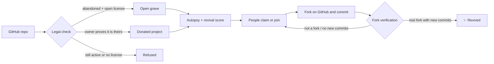

# 🪦 Digital Graveyard

**Find abandoned open-source projects you're allowed to revive, see why each one died, and bring it back, alone or with others.**

🌐 Live at **[digitalgraveyard.cv](https://digitalgraveyard.cv)**

Thousands of good open-source projects die every year. The maintainer gets a job, burns out or loses interest, and the code freezes. Three questions stop people from picking them up again:

1. **Am I allowed to?** Is it legal to continue someone else's project?
2. **Why did it die?** Will I hit the same wall?
3. **Will anyone know it was me?** If I do the work, how do I prove it?

Digital Graveyard answers all three, using data nobody can fake: the project's **license**, its **GitHub history**, and **git commits** as proof of work.

---

## How it works



### 1. Only legally revivable code is listed
A repo becomes an **open grave** only if both are true:
- **It is abandoned:** archived by its owner, or no code pushed for 12+ months.
- **Its license already allows forking:** MIT, Apache-2.0, BSD, ISC, MPL, GPL, LGPL, AGPL, Unlicense, CC0 and similar.

Because the license already gives everyone permission to copy and modify the code, nobody needs to ask the owner. The original author is credited on every page, and the original repository is never touched or hosted here. Repos with no license are refused, since by default nobody may reuse them. Anything else can only be listed by its owner, as a **donated project**, after they prove ownership by linking their GitHub account.

### 2. Every grave gets an autopsy
Built from the repo's real commit history, contributor stats and issues:
- **Peak activity:** the busiest year and its commit count.
- **Cause of decline:** Maintainer Departure, Solo Maintainer Burnout, Overwhelmed by Issues, Abrupt Stop, Gradual Fade-out, Low Adoption or Stalled Development.
- **Revival path:** where the next person should start.

### 3. Revival score (0 – 100)

| Factor | Weight | What it measures |
|---|---|---|
| Freshness | 25 | How recently it died (linear over 8 years) |
| Documentation | 20 | README length and quality |
| Maintenance | 20 | Share of issues that were closed |
| Community | 20 | Contributors and pull requests (log scale) |
| Adoption | 15 | Stars and forks (log scale) |

Difficulty: **≥ 75 Easy**, **≥ 50 Medium**, otherwise **Hard**.

### 4. Claims: a pledge so nobody squats and disappears
Every claim works the same way, for open graves and donated projects:

| Step | Rule |
|---|---|
| Claim | Lock a **150-credit pledge**. You need a linked GitHub account. |
| Day 7 | GitHub must show **a commit of yours** on a fork of the repo. |
| Finish | **3+ new commits** on the fork (at least one yours) before the claim ends (14, 30 or 60 days, set by the lister). |
| Revived | Pledge back **+100 credits** and reputation, plus the project's bounty if it has one. |
| Quit | Any time. **Full pledge back, no penalty.** |
| Disappear | Missing day 7 or the deadline without quitting: the pledge goes to the **project's bounty** for the next reviver, −10 reputation and 1 strike. 3 strikes and you can't claim any more. |

- Everyone starts with **500 credits**: enough for 3 claims at once, not a 4th. Credits have no cash value.
- **Open graves** take any number of revivers at once. The first verified fork becomes the community fork.
- **Donated projects** (your own repo) take one claimer at a time. The owner approves the request within 3 days, or it expires and the pledge is returned. The owner never reviews the code and never receives lost pledges, so nobody gains from failing a claimer.
- The daily job runs the day-7 and deadline checks against GitHub. If it finds 3+ commits it pays out even if the reviver never pressed "Check my fork". If GitHub can't be reached it tries again the next day instead of penalising anyone.
- Every money step runs in one database transaction with guarded status changes, so a double click or two people claiming at the same moment can't pay out, refund or overdraw twice. An append-only ledger records every credit movement.

### 5. Git is the proof of work
A revival only counts when the server confirms, through the GitHub API, that:
- The repo is a **real fork** of the original.
- It has **new commits made after the claim**.
- **At least one of those commits is the claimer's** (matched to their linked GitHub account).

### 6. Anyone can grow the catalogue
Listing needs a public GitHub repo that is not a fork. Your own repo becomes a donated project; someone else's needs to be abandoned and under an open license. The full form asks for what a claimer needs before pledging: what "done" means, starter tasks, a time estimate, the claim length, a handoff letter, and whether you'll answer questions. The **🔎 Suggest a Dead Repo** box takes just a link. Each account can list 10 repos a day.

---

## Where the data comes from

Every grave, score and autopsy comes from **GitHub's public API**. The starting catalogue was built by [`scripts/seed-open-graves.mjs`](scripts/seed-open-graves.mjs), which searches GitHub for repos that are archived, popular (100–500+ stars depending on category), untouched since before 2023, and under an open license, across categories like Web, AI/ML, Mobile, Games, Security and DevTools. New graves are added by users through the suggest box.

The only made-up data is a handful of **demo accounts** (`@campus.edu` emails) used for presenting.

---

## Tech stack

| Layer | Choice |
|---|---|
| Framework | Next.js 14 (pages router), React 18 |
| API | Next.js API routes + a GraphQL endpoint (GraphQL Yoga) at `/api/graphql` |
| Database | PostgreSQL on [Neon](https://neon.tech), via Prisma 5 |
| Data source | GitHub GraphQL + REST APIs (commits, contributor stats, license, forks, compare) |
| Auth | Email + bcrypt passwords, optional GitHub OAuth, HMAC-signed `HttpOnly` session cookie |
| Hosting | Vercel, with a daily cron job that runs the claim checks |

### Security notes
- Users are shown to each other only by random aliases like `Digger-1042`; emails and GitHub identities stay private.
- The legal check, fork verification and every credit movement run on the server, so the browser can't skip them.
- The cron endpoint requires `CRON_SECRET`.
- Demo persona switching only works for demo accounts.

---

## Project structure

```
components/   UI: project cards, autopsy chart, revival checklist, navbar, provenance timeline
context/      AppContext: signed-in user, projects, API calls
lib/
  githubIntelligence.js   GitHub analysis, revival score, open-license list
  listing.js              legal check: abandoned + open license, or owner
  revivers.js             community revival status and crew
  mockFallback.js         autopsy diagnosis (diagnoseDecline) and project enrichment
  ledger.js               append-only credit ledger
  auth.js                 sessions, password hashing
  graphql/                GraphQL schema and resolvers
pages/
  index, browse, project/[id], submit, dashboard, about (Manifesto), login, signup
  api/
    projects/             list, create, suggest, claim
    commitments/          submit fork, withdraw, review
    auth/                 login, signup, GitHub OAuth, demo personas
    cron/timeout-check    daily claim checks (day 7, deadline, expired requests)
prisma/schema.prisma      User, Project, Commitment, Milestone, LedgerEntry
scripts/                  local database, seeding, tests, Vercel DB setup
docs/demo-script.html     class demo walkthrough and pitch
```

---

## Running it locally

Requires **Node.js 18+**. No database install needed: the project ships an embedded PostgreSQL.

```bash
git clone https://github.com/Harshita445/digital_graveyard_swe.git
cd digital_graveyard_swe
npm install
cp .env.example .env
```

Start the local database and the dev server together:

```bash
npm run dev:local
```

Open http://localhost:3000. The local database lives in `.pgdata/` and runs on port 5433.

In a second terminal, fill it with demo accounts and real graves:

```bash
npm run seed
```

```bash
GITHUB_TOKEN=$(gh auth token) npm run seed:graves
```

> ⚠️ `npm run seed` **wipes every table** before seeding. Only run it against your local database, never production.

### Environment variables

See [`.env.example`](.env.example). The important ones:

| Variable | Needed for |
|---|---|
| `DATABASE_URL` | Postgres connection string |
| `GITHUB_TOKEN` | Repo analysis, the suggest box and fork verification |
| `SESSION_SECRET` | Signing session cookies |
| `CRON_SECRET` | Protecting the daily cron endpoint |
| `GITHUB_CLIENT_ID` / `GITHUB_CLIENT_SECRET` | Optional "Connect GitHub" sign-in |
| `NEXT_PUBLIC_BASE_URL` | OAuth callback base URL |

### Scripts

| Command | What it does |
|---|---|
| `npm run dev:local` | Embedded Postgres + Next.js dev server |
| `npm run dev` | Dev server against `DATABASE_URL` |
| `npm run build` | Applies the schema safely (no data loss), then builds |
| `npm run seed` | Demo accounts (local only, wipes data) |
| `npm run seed:graves` | Adds real abandoned repos from GitHub (additive) |
| `npm test` | Full test suite: claim engine, auth, listing rules and API (HTTP parts need a running server) |
| `npm run test:claims` | Claim engine only: pledges, checkpoints, payouts, races (local database) |
| `npm run lint` | ESLint |

---

## Deployment

The live site runs on **Vercel** with a **Neon** Postgres database.

1. Import the repo into Vercel and attach a Neon database (Vercel → Storage). This sets `DATABASE_URL`.
2. Add `GITHUB_TOKEN`, `SESSION_SECRET` and `CRON_SECRET` in Project Settings → Environment Variables.
3. Deploy. `npm run build` runs [`scripts/vercel-db-setup.mjs`](scripts/vercel-db-setup.mjs), which applies the Prisma schema with `db push` and refuses any change that would lose data.
4. [`vercel.json`](vercel.json) schedules `/api/cron/timeout-check` daily.

Every push to `main` deploys automatically.

---

## Demo

A step-by-step class demo with the pitch, two people reviving one grave side by side, and likely questions is in [`docs/demo-script.html`](docs/demo-script.html).

---

## Course context

Built as a Software Engineering course project. Progress and test reports from earlier milestones (when the project was called *Gravefin*) are the PDFs in the repo root, and the original proposal is in [`project-proposal/`](project-proposal/).
